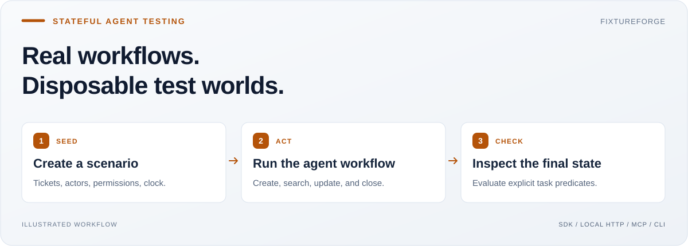
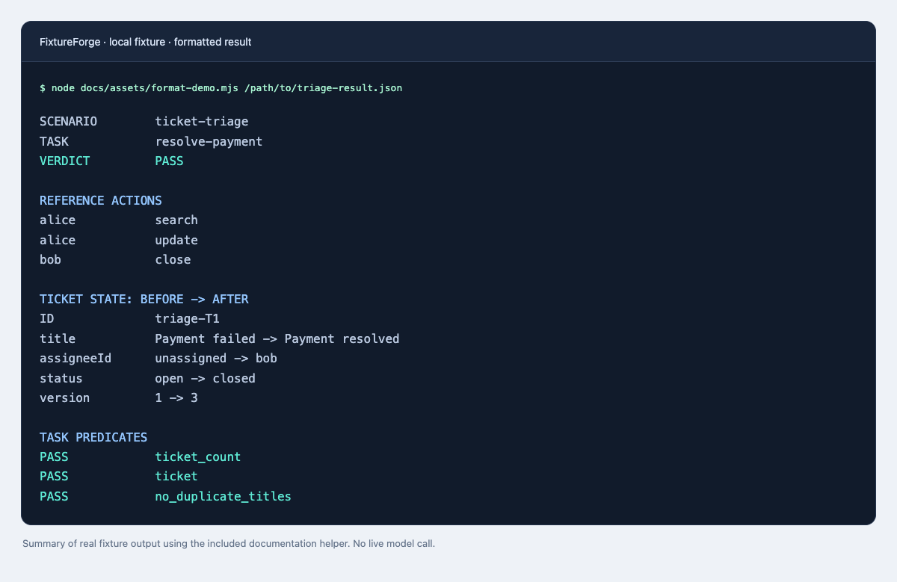
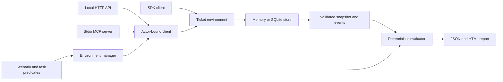

<h1 align="center">FixtureForge</h1>
<p align="center"><strong>A stateful test world for AI agents.</strong></p>
<p align="center">An SDK, CLI, HTTP service, and MCP server that give agents a local ticket system with real state transitions, permissions, and repeatable success checks.</p>

<p align="center">
  <a href="https://github.com/Balaji91221/fixtureforge/actions/workflows/ci.yml"></a>
  <a href="LICENSE"></a>
  <a href="#quick-start"></a>
  <a href="#usage"></a>
  <a href="#mcp-server"></a>
</p>

<p align="center">
  <a href="#why-i-built-it">Why</a> ·
  <a href="#quick-start">Quick start</a> ·
  <a href="#usage">Usage</a> ·
  <a href="#architecture">Architecture</a> ·
  <a href="#docs">Docs</a>
</p>



## Why I built it

I built FixtureForge because AI engineering needs repeatable environments where an action changes what happens next. A fixed JSON response can show that a tool was called. A stateful fixture can show whether a ticket was created, found, assigned, and closed correctly.

The goal is to make agent behavior testable without connecting a real support account. It is useful for developers building agent workflows, MCP tools, and evaluation suites that need known starting states and observable outcomes.

## The problem → the solution

An agent says, “I assigned the payment issue to Bob and closed it.” A mock response can say `success` even when the later search still returns an open, unassigned ticket.

**FixtureForge keeps the state consistent across calls and checks it against explicit task predicates.** The verdict comes from tickets and events, not the agent's explanation.

| What makes agent testing hard? | What FixtureForge provides |
| --- | --- |
| Each mock call is disconnected from the previous one | Create, search, update, assign, and close one shared ticket state |
| Runs start from different data | Seeded scenarios, deterministic time, and resettable snapshots |
| A tool lets the wrong actor access a ticket | Actor permissions and namespace-scoped credentials |
| A fluent answer hides an unfinished task | `PASS` / `FAIL` checks with state and event evidence |

### Core capabilities

- **Stateful ticket workflows:** optimistic versions, legal transitions, and operation-key deduplication.
- **Repeatable scenarios:** seeded data and known-solution traces that are validated before use.
- **Isolated persistent runs:** one SQLite file per namespace, plus reset, restore, and explicit cleanup.
- **Multiple interfaces:** an in-process SDK, CLI, authenticated local HTTP API, and actor-bound stdio MCP server.
- **Inspectable results:** task predicates, before/after diffs, event timelines, and HTML reports.

## Quick start

Requires **Node.js 22.18+** for built-in SQLite. No model API key or live customer account is required.

```bash
git clone https://github.com/Balaji91221/fixtureforge.git
cd fixtureforge
npm ci
npm run build

demo_root="$(mktemp -d)"
node dist/cli.js run \
  --scenario examples/scenarios/ticket-triage.json \
  --output "$demo_root/triage.html"
```

Expected result: **`evaluation.verdict: "PASS"`**. The seeded payment ticket is renamed “Payment resolved,” assigned to Bob, and closed. Open the generated `triage.html` to inspect the state changes.



*Formatted summary of the included reference trace, generated with the [documentation helper](docs/assets/README.md). This is a local fixture demonstration, not a live model performance result.*

Try the intentionally impossible reopening scenario:

```bash
node dist/cli.js run --scenario examples/scenarios/impossible.json
```

Expected result: **`FAIL`**, exit 1. Invalid input or an infrastructure error exits 2; a passing task exits 0. An “impossible” label describes the fixture's intended test case, not a general proof of unsolvability.

## Usage

### Install the SDK in another project

Version **0.2.0** is available as source and is **not published to npm**. Pack it locally, then install the compiled ESM package in your application.

```bash
# In this repository:
npm pack

# In your consuming project:
npm install /absolute/path/to/ai-opensource-local-fixtureforge-0.2.0.tgz
```

```js
import { TicketEnvironment } from '@ai-opensource-local/fixtureforge';

const tickets = new TicketEnvironment({ alice: 'member' }, 'example');
try {
  const ticket = tickets.create('alice', 'Payment failed', 'payment-1');
  const closed = tickets.closeTicket('alice', ticket.id, ticket.version);
  console.log(closed.id, closed.status, closed.version);
  // example-T1 closed 2
} finally {
  tickets.dispose();
}
```

Use `EnvironmentManager` when runs need SQLite persistence and scoped credentials. The [usage guide](docs/usage.md) includes the persistent SDK, local HTTP API, snapshots, reset, restore, and evaluation recipes.

### MCP server

Create a run first, retain its credentials privately, and set `FIXTUREFORGE_ACTOR_TOKEN` to that run's chosen actor token. Configure your MCP client to launch:

```bash
node /absolute/path/to/fixtureforge/dist/cli.js mcp \
  --dir /absolute/fixture-runs --run trial
```

The six tools are `ticket_create`, `ticket_search`, `ticket_get`, `ticket_update`, `ticket_transition`, and `ticket_close`. For the triage fixture, `ticket_search({"query":"Payment"})` finds `triage-T1` when connected as Alice.

The server binds one actor and namespace at startup. Tools cannot switch either or perform owner operations such as reset and destroy. Follow the [setup and credential guide](docs/usage.md#mcp-integration); the HTTP service is a separate interface, not an HTTP MCP transport.

## Architecture



| Component | Responsibility |
| --- | --- |
| [`src/domain.ts`](src/domain.ts) | Ticket rules, permissions, versions, time, and snapshot validation |
| [`src/storage.ts`](src/storage.ts) | SQLite transactions, run ownership, credentials, and cleanup |
| [`src/scenarios.ts`](src/scenarios.ts) | Scenario loading, task predicates, reference traces, and reports |
| [`src/http.ts`](src/http.ts) | Local HTTP routes and bearer-credential handling |
| [`src/mcp.ts`](src/mcp.ts) | Six tools bound to a single run and actor |
| [`src/cli.ts`](src/cli.ts) | Composition of runs, services, and owner operations |

Read the [HLD and LLD](docs/architecture.md) for storage contracts, transaction boundaries, lifecycle rules, and design tradeoffs.

### Boundaries

FixtureForge simulates a small ticket service. Passing its tasks does not establish competence on real services. The SQLite store serializes validated snapshots and is intended for local test workloads, not a hosted production backend.

Credentials are excluded from canonical snapshots. Reset and restore rotate actor tokens; graceful transient shutdown cleans up its run, while crashes need explicit cleanup. The legacy `serve PORT` command is an insecure in-memory demo; use the documented credential-bound interfaces for agent tests. See [security guidance](SECURITY.md).

## Docs

| Start here | Go deeper |
| --- | --- |
| [Usage and integration recipes](docs/usage.md) | [Architecture: HLD and LLD](docs/architecture.md) |
| [Example scenarios](examples/scenarios) | [Persistence decisions](docs/decisions/002-persistence-and-scope.md) |
| [Implementation and verification status](IMPLEMENTATION_STATUS.md) | [Original project plan](PROJECT_PLAN.md) |

```bash
npm run typecheck
npm test
```

Tests cover state transitions, version conflicts, namespace isolation, deterministic replay, restore validation, credential rotation, HTTP, MCP, and cleanup. The CI badge links to current hosted results.

Contribute through [issues](https://github.com/Balaji91221/fixtureforge/issues) and pull requests after reading [CONTRIBUTING.md](CONTRIBUTING.md). Original code is available under the [MIT license](LICENSE).
