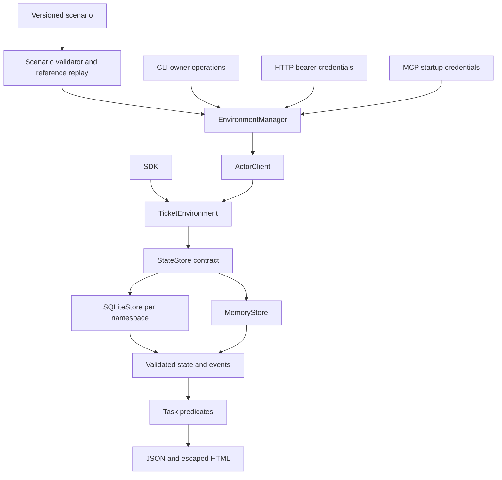

# FixtureForge architecture

[← Project overview](../README.md) · [Usage guide](usage.md)

This describes the implemented 0.2.0 local ticket simulator. Its stable core is a ticket lifecycle and deterministic task evaluation. HTTP, MCP, CLI, and SDK callers share those domain rules.

## HLD: one domain, several interfaces



A persistent namespace owns one SQLite file. HTTP and MCP are local process adapters, not hosted control-plane services. A caller can instead use the in-memory SDK for small tests without creating a server or database.

Scenario data declares the starting state and success conditions. A model may interact with the tools, but the stored state and deterministic evaluator decide whether a task passed.

## LLD: modules and contracts

| Module | Main types/functions | Responsibility |
| --- | --- | --- |
| [`domain.ts`](../src/domain.ts) | `TicketEnvironment`, `StateStore`, `MemoryStore`, `validateSnapshot` | Ticket rules, actor access, optimistic versions, deterministic time, and state validity |
| [`storage.ts`](../src/storage.ts) | `SQLiteStore`, `EnvironmentManager`, `ActorClient`, `createEnvironment` | Persistence, namespace lifecycle, owner/actor credentials, and handle cleanup |
| [`scenarios.ts`](../src/scenarios.ts) | `loadScenario`, `dispatch`, `runScenario`, `evaluate`, `stateDiff`, `eventTimeline` | Scenario contracts, trace replay, task checks, and reports |
| [`http.ts`](../src/http.ts) | `createHttpServer` | Routes, request/response mapping, and bearer credential handling |
| [`mcp.ts`](../src/mcp.ts) | `FixtureMcpServer`, `serveMcp` | MCP lifecycle and six actor-bound ticket tools |
| [`cli.ts`](../src/cli.ts) | Command composition | Creates concrete managers and adapters; maps verdicts to exit codes |

### StateStore is the persistence boundary

```ts
interface StateStore {
  read(): Snapshot;
  transact<T>(fn: (state: Snapshot) => T): T;
  close(): void;
}
```

`TicketEnvironment` depends on this contract, not SQLite. Transactions are synchronous; a callback returning a Promise is rejected. Read values and transaction results are cloned; transaction callbacks are trusted.

`MemoryStore` applies changes to a copy and commits the copy only after successful execution and result cloning. `SQLiteStore` reads current state inside `BEGIN IMMEDIATE`, applies the same domain operation, validates/serializes the snapshot, and commits atomically. Errors roll back. Independent handles therefore see current state and detect stale ticket versions.

The SQLite representation has a validated JSON snapshot in a state row plus a metadata table. It favors understandable small fixtures over normalized tables and high-throughput queries.

### Ownership and credentials

`EnvironmentManager.create(scenario, id)` returns `{id, credentials, snapshot}`. Credentials contain an owner token and one actor token per scenario user. Only token hashes are stored in the database.

`openActor(id, token)` returns an `ActorClient`, whose `call(tool, args)` is bound to the resolved actor. Persistent access revalidates credentials, including through already-open handles after reset/restore. Owner methods include snapshot, evaluate, report, reset, restore, advance, and destroy.

The persistent MCP adapter exposes actor operations only. Administrative reset/restore/destroy is not available as an agent tool. HTTP uses the same actor client/domain path. Direct SDK callers controlling a `TicketEnvironment` can choose actor identifiers; the SDK is not a security boundary against its own host process.

## Data model and invariants

| Record | Important fields and rules |
| --- | --- |
| `Ticket` | ID, title, owner, optional assignee, status, version, timestamps |
| `Event` | Sequence, simulated timestamp, actor, action, before/after ticket state |
| `Snapshot` schema 2 | Users, seed, clock, tick size, next ID, tickets, events, idempotency results |
| `Scenario` schema 1 | Seeded tickets/users, task predicates, solvability label, optional reference actions |
| SQLite schema 1 | Application/schema markers, state revision, scenario/baseline, credential hashes |

Tickets start at version 1. Update and transition calls require the current `expectedVersion`. A member can access their own or assigned tickets; an admin can access all. Assignment explicitly grants access to the assignee.

Allowed lifecycle transitions are `open → in_progress`, `open → closed`, and `in_progress → closed`. Closed tickets cannot be edited or reopened. The API rejects stale versions and invalid transitions with domain errors; HTTP maps conflicts to 409 and forbidden access to 403.

A create call can carry an `operationKey`. Reusing it with the same actor and normalized title returns the recorded result; reusing it with different input causes a conflict. This prevents retries from silently creating duplicate effects.

Ticket IDs derive from the seed and sequence. Mutation timestamps use a simulated clock; every mutation advances it by the configured tick. Owner-controlled clock advancement is also recorded. Random credentials are intentionally excluded from canonical snapshots, so identical scenario/actions can yield equal snapshots.

## One workflow, end to end

1. The loader validates `ticket-triage.json`, constructs its seeded ticket state, and replays the declared known solution to verify its predicates.
2. The manager creates a namespace exclusively and stores its baseline, task, and credential hashes.
3. An actor-bound client searches for “Payment” and receives the visible seeded ticket `triage-T1` at version 1.
4. Alice updates the title and assignee using `expectedVersion: 1`. Permission checks, state changes, clock, event history, and version 2 commit together.
5. Bob or the owning Alice closes the ticket using `expectedVersion: 2`; the ticket reaches version 3.
6. The owner evaluator checks that exactly one ticket remains, its expected fields match, and no duplicate title exists.
7. A report includes each predicate's result, actual values, evidence IDs, before/after diff, and event timeline.

A version mismatch leaves the prior state intact. The agent must fetch current state and decide its next action; the store does not silently overwrite a concurrent change.

## Deterministic evaluation

Supported predicates are `ticket_count`, `ticket` field equality, `all_closed`, `event_count`, and `no_duplicate_titles`. All must pass for the task to pass. Predicate filters cannot truncate matches with `limit`; `all_closed` is non-vacuous unless `allowEmpty` is explicitly true.

Known-solution scenarios require a reference trace that succeeds before storage is created. `intentionally-impossible` is a dataset label; `unverified` allows experiments without a solvability claim. Scenario/action data does not execute arbitrary code.

`runScenario` replays the supplied or reference actions in memory, records domain errors in the trace, and evaluates the resulting snapshot. The persistent manager evaluates its stored namespace instead. Neither path uses an LLM judge.

## Lifecycle, restore, and failure behavior

- **Create:** requires a fresh namespace ID; files are created exclusively with restricted permissions.
- **Reset:** restores the original baseline and rotates actor credentials, including for open clients.
- **Restore:** validates schema 2, event/state consistency, and matching seed/users before changing storage; actor credentials rotate on success.
- **Destroy:** marks the environment destroyed, revokes actor access, closes tracked handles, and removes its database files.
- **Transient start:** owns cleanup on graceful shutdown. `--persist` retains the namespace; a crash or SIGKILL requires explicit later cleanup.

Owner tokens survive reset/restore. Do not infer authorization from a snapshot: credentials are separate. Unknown database/snapshot schemas are rejected rather than migrated destructively. Preserve a closed database copy before future migration work.

## Design choices and tradeoffs

- **Single responsibility:** domain rules live in `TicketEnvironment`; adapters translate protocols; the manager owns namespace lifecycle; task predicates own evaluation.
- **Replaceable storage:** both stores obey the small `StateStore` contract and preserve transaction behavior. The domain does not branch on the storage implementation.
- **Small agent interface:** `ActorClient.call` exposes task actions while owner controls remain separate. Adding a transport can reuse the same dispatcher.
- **Explicit extension cost:** a new ticket predicate extends the scenario validator/evaluator. A different simulated service would need its own domain, not a name switch inside ticket rules.
- **Local-first storage:** one snapshot per namespace makes replay/restore transparent. Large datasets, concurrent distributed agents, and production tenancy would need a different operational design.

Composition keeps infrastructure outside ticket business rules without introducing a generic workflow engine or unnecessary class hierarchy.

## LLM boundary and trust limits

FixtureForge has no model provider dependency or scenario-generation runtime. An external agent can call the supported tools; it cannot alter actor permissions, namespace identity, or success predicates through those tools.

Passing a local fixture task is evidence about that task only. It does not establish competence against a real service's behavior. Loopback binding, scoped credentials, and path validation do not isolate a malicious process with the same OS account and filesystem access.

Use the authenticated persistent interfaces for agent integrations. Legacy `serve PORT` intentionally preserves an insecure in-memory demo and is not the credential-bound service.

## Verification

[`test/`](../test) covers domain transitions, conflicts, deterministic snapshots, SQL rollback, independent handles, namespaces, credential revocation, restore validation, graceful cleanup, HTTP, and actual MCP subprocesses. From the repository root, run `npm run typecheck`, `npm run build`, and `npm test`.

See [usage recipes](usage.md), [persistence decisions](decisions/002-persistence-and-scope.md), and [security guidance](../SECURITY.md) before extending storage or a transport.
